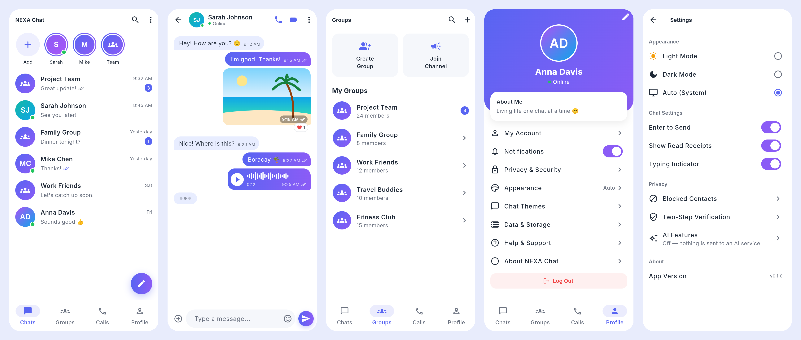
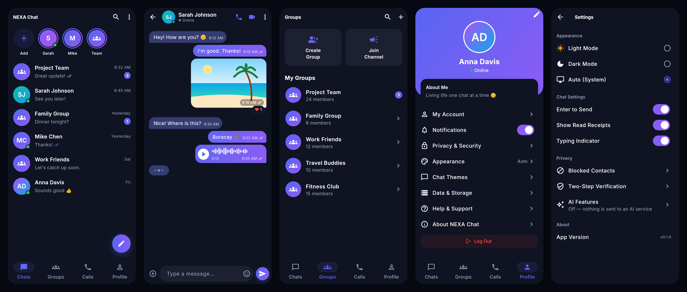

# NEXA

Smart messaging that turns conversations into actions — chat, plus tasks,
decisions and (later) AI assistance, while keeping messaging simple,
reliable and secure. See [`docs/product-proposal.txt`](docs/product-proposal.txt)
for the full vision and [`docs/ROADMAP.md`](docs/ROADMAP.md) for build status.

## Repository layout

| Path | What |
|---|---|
| `app/` | Flutter mobile client (Material 3, NEXA theme) |
| `backend/` | FastAPI API + WebSocket real-time server |
| `design/` | Theme sheet and `tokens.json` (single source for colors) |
| `docs/` | Product proposal, roadmap |

## Backend

```bash
cd backend
python -m venv .venv && source .venv/bin/activate
pip install -r requirements-dev.txt
uvicorn app.main:app --reload        # http://localhost:8000/docs
pytest
```

Configuration (environment variables):

| Variable | Default | Notes |
|---|---|---|
| `NEXA_DATABASE_URL` | `sqlite:///./nexa-dev.db` | Use `postgresql+psycopg://…` in production |
| `NEXA_AUTH_MODE` | `dev` | `firebase` verifies Firebase ID tokens. **Never run `dev` in production.** |
| `NEXA_CORS_ORIGINS` | `*` | Comma-separated list |
| `ANTHROPIC_API_KEY` | — | Needed for the Jarvis assistant (`/assistant/chat`); stays on the server |
| `NEXA_ASSISTANT_MODEL` | `claude-opus-5-5` | Claude model behind Jarvis |

In dev mode, authenticate with `Authorization: Bearer dev:<uid>` (or
`dev:<uid>:<Display Name>`); the WebSocket takes the same token as `/ws?token=…`.

### MVP API

- **Messaging** — `POST/GET /conversations`, `GET/POST /conversations/{id}/messages`
  (cursor via `before`), `POST /conversations/{id}/read`. A `client_id` on a
  message makes retries idempotent, so an offline queue can safely resend.
- **Real time** — `WS /ws`: receives `message.new`, `task.*`, `poll.updated`,
  `typing`; sends `message.send`, `typing`.
- **Chat-to-Task** — `POST /messages/{id}/task` (one tap; message text becomes
  the title), `POST/GET /conversations/{id}/tasks`, `GET /tasks/mine`, `PATCH /tasks/{id}`.
- **Decision Rooms** — `POST/GET /conversations/{id}/polls`, `PUT /polls/{id}/vote`,
  `POST /polls/{id}/decision` (creator records the outcome; `?decided_only=true`
  gives the decision history).
- **Smart Inbox** — `GET /inbox[?category=work]`: conversations ranked by
  awaiting-my-reply, unread, recency, with open-task counts.
  `PUT /conversations/{id}/category` files a chat as personal/work/important.
- **Jarvis assistant** — `POST /assistant/chat` with `{text, history, utc_offset_minutes}`
  returns `{reply, actions}`. Claude runs a tool loop over the caller's own data
  (inbox, read a chat, send a message, list/create/complete tasks); every tool is
  scoped to conversations the user belongs to.

## App

The Flutter SDK is needed (3.27+). Android and iOS folders are committed
(the Jarvis background service needs manifest entries).

```bash
cd app
flutter pub get
flutter run \
  --dart-define=NEXA_API_URL=http://10.0.2.2:8000 \
  --dart-define=NEXA_TOKEN=dev:me:Me \
  --dart-define=PICOVOICE_ACCESS_KEY=<key>   # optional, enables the "Jarvis" wake word
```

### Jarvis (voice assistant)

The **Jarvis** tab is a hands-free assistant: tap the orb (or say "Jarvis")
and ask things like *"What's waiting on me?"*, *"Summarise the Project chat"*,
*"Remind me to send the deck Friday"* or *"Tell Bob I'm running late"*. Speech is
recognised on the phone, the text goes to `POST /assistant/chat`, and the reply is
spoken aloud; actions taken (task created, message sent…) are listed under it.

- **Wake word** — on-device "Jarvis" detection with Picovoice Porcupine. Get a
  free AccessKey at console.picovoice.ai and pass it as `PICOVOICE_ACCESS_KEY`.
  No audio leaves the phone until you speak a request.
- **Background mode** (Android) — a foreground service with a notification keeps
  Jarvis alive with the app closed: the wake word keeps listening, the
  notification shows an inbox digest ("2 waiting on you · 3 open tasks",
  refreshed every 5 minutes without any AI call) and has **Talk** / **Turn off**
  buttons. To pop up over other apps on the wake word, allow *Display over other
  apps* when asked. iOS does not allow background wake-word listening, so there
  Jarvis works while the app is open.
- Toggle both in the Jarvis tab's settings (sliders icon).




The app runs on demo data, following `design/mockups/nexa-chat-screens.png`:
Chat List (stories row; Smart Inbox filters in the ⋮ menu), Conversation
(text, photo, voice, reactions, typing; long-press a message → create task),
Groups, Profile and Settings (light/dark/auto theme). Inter is bundled under
`assets/fonts/inter` (OFL) so text renders correctly offline. Colors live in `lib/theme/nexa_colors.dart`, matching
`design/tokens.json`.
